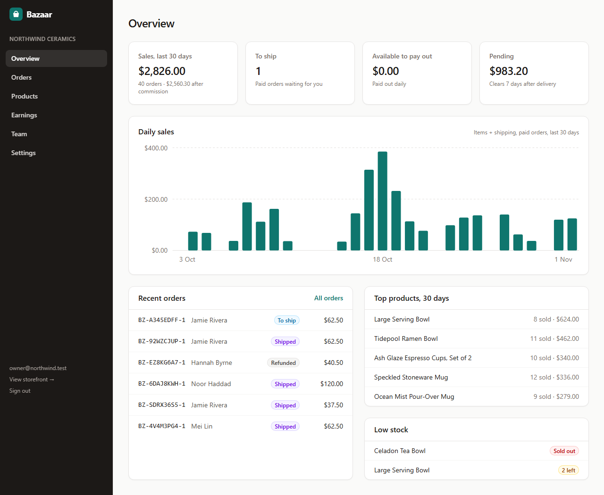
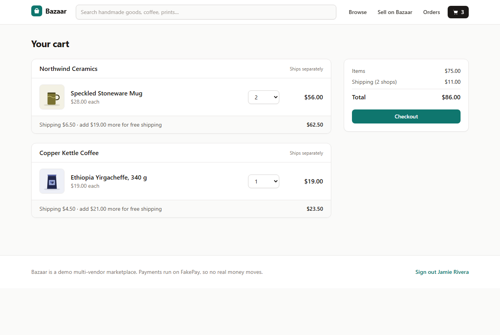
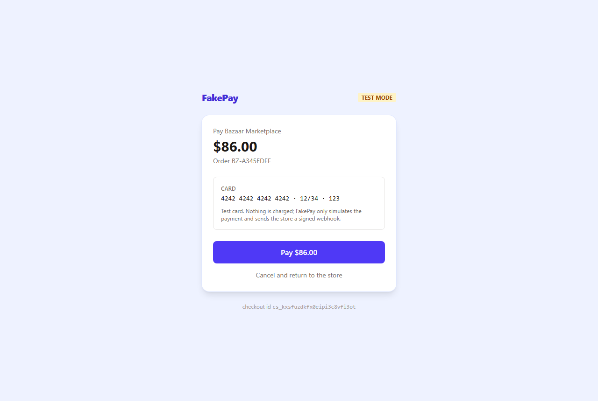
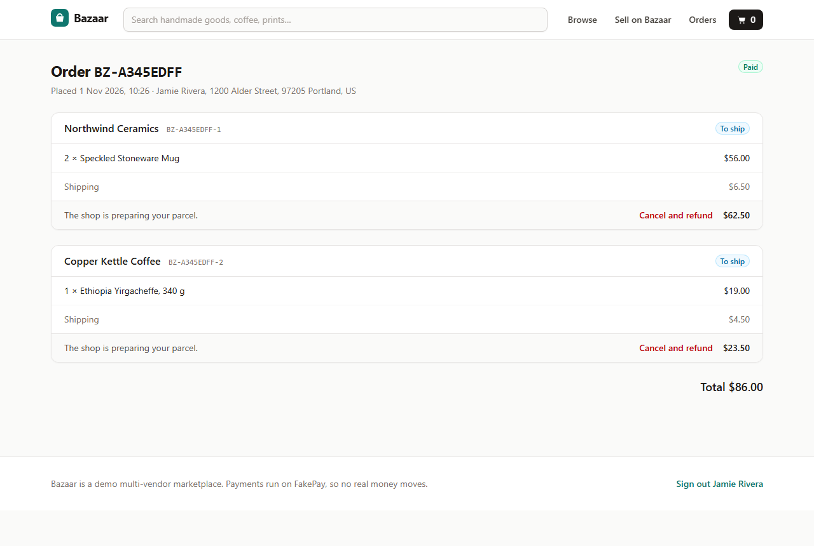
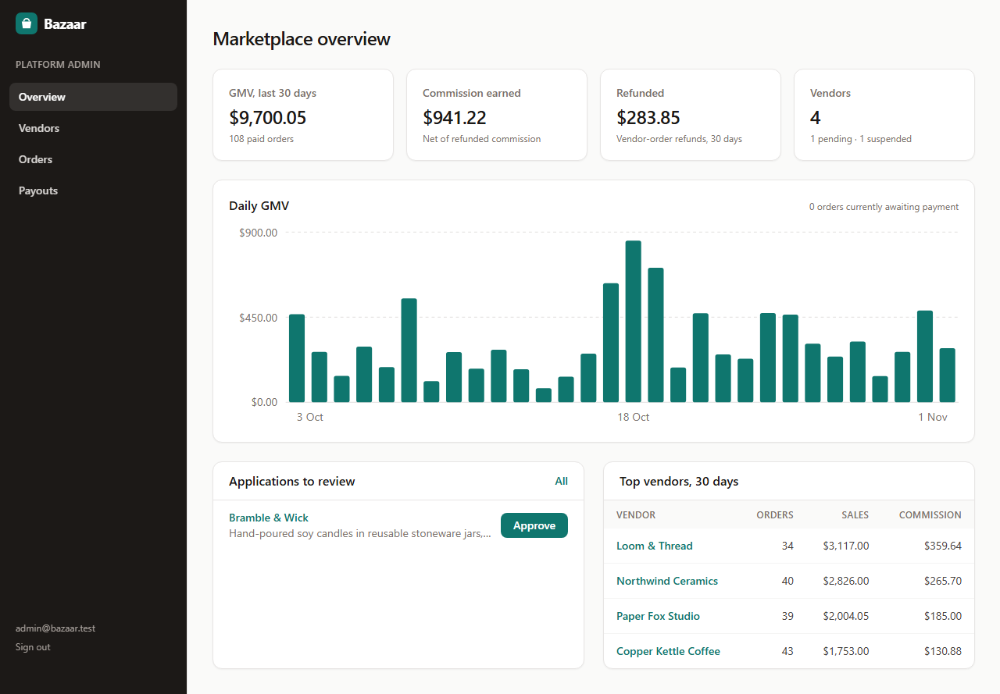
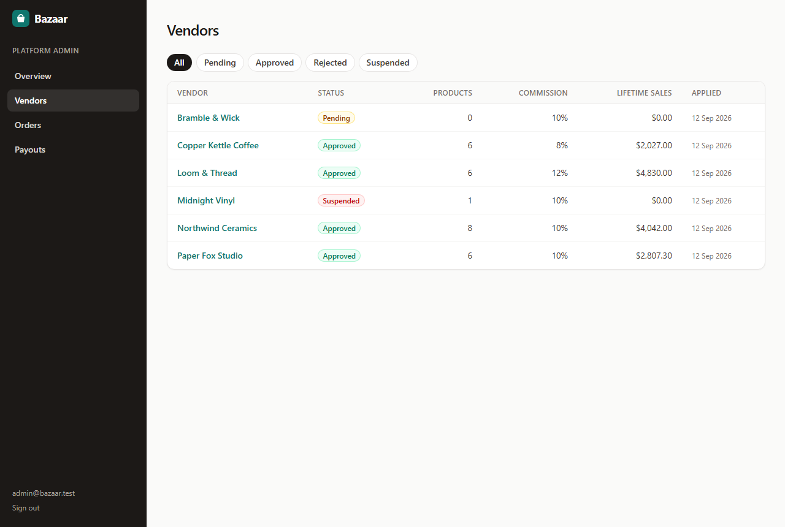
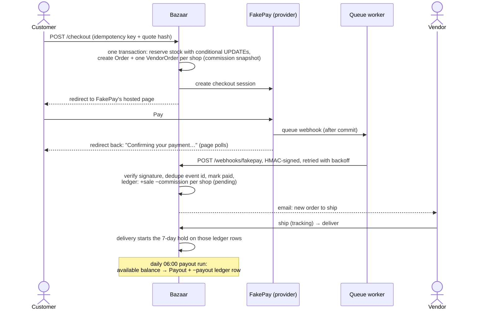
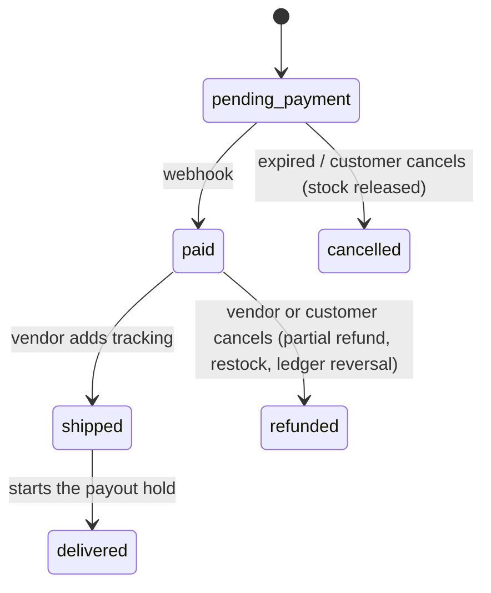

# Bazaar: a Laravel multi-vendor marketplace

Independent shops sell through one storefront, and a customer buys from several of them in one cart and pays once. That makes a marketplace harder than a normal shop. One payment has to become separate orders that each shop ships, refunds and gets paid for on its own. The platform takes a commission. Vendors are paid only once the goods have arrived. Nobody may oversell the last item, double-charge a customer or pay a vendor twice.

**Bazaar** does this on Laravel 13. People sign up as vendors and admins approve them. Vendors list products, and checkout splits each order into one part per vendor. Payment goes through a hosted page and a signed webhook, and stock is reserved and expires if nobody pays. Every vendor's money lives in an append-only ledger, from which a daily job makes the payouts. Vendors and the platform admin each have their own dashboard. The payment provider is **FakePay**, a stand-in built into the app (hosted checkout, refunds, signed webhooks with retries), so the whole money flow runs with no third-party accounts.



| | |
|---|---|
|  |  |
|  |  |
|  |  |
|  |  |

The screenshots come from a real run against the seeded demo data: [scripts/screenshots.py](scripts/screenshots.py) drives Chromium through the full flow and checks it as it goes. A shopper fills a cart from two shops, pays on FakePay and waits for the webhook. The vendor ships its part. The customer sees the tracking number for one part, while the other is still "To ship".

## What it does

**Customers** browse, search and filter the catalogue and fill one cart from several shops. The cart shows each shop's part, its shipping and how far off free shipping is. They check out once and pay once. Afterwards they follow each part of the order separately and can cancel any part that hasn't shipped yet, which refunds that part.

**Vendors** apply for a shop, and once approved they get a dashboard:
- sales over 30 days, orders to ship, available and pending balances, top products and low stock,
- product management with image upload,
- an order queue with ship, deliver and refund actions,
- a ledger and payout history,
- shop settings (flat shipping, a free-shipping threshold, the low-stock level),
- staff accounts that can manage products and orders but not settings or the team.

**Admins** approve or reject applications, suspend and reinstate shops, set each shop's commission rate, browse all orders, and run payouts on demand. The admin dashboard shows GMV, the commission actually kept (net of refunds), refunds and the top vendors.

## How the money flows



Each part of an order has its own state machine ([VendorOrderStatus](app/Enums/VendorOrderStatus.php)):



## The parts that are easy to get wrong

| Problem | How it's handled | Where |
|---|---|---|
| Two buyers, one item left | Stock is reserved with `UPDATE … SET stock = stock - ? WHERE stock >= ? AND price = ? AND status = 'active'` inside the checkout transaction, never read-then-write. If one line fails, every reservation made before it rolls back. | [PlaceOrder](app/Checkout/PlaceOrder.php) |
| Double-click or refresh on "Pay" | The checkout form carries an idempotency key (unique per user). A resubmit returns the order the first submit created. | [PlaceOrder](app/Checkout/PlaceOrder.php) |
| The price changes while the customer is on the checkout page | The page posts back a hash of exactly what it showed (lines, prices, shipping). If a fresh quote differs, nothing is placed and the customer reviews the new totals. | [CartQuote](app/Cart/CartQuote.php) |
| Webhooks arrive twice, late or out of order | The event id is recorded in the same transaction as its effects, so a duplicate is a no-op and a crash halfway through lets the retry redo all of it. A payment for an order that already expired, a second payment for a paid order, and a wrong amount are each **refunded**, never ignored. | [PaymentProcessor](app/Orders/PaymentProcessor.php) |
| The expiry job runs while the payment is in flight | Before cancelling an unpaid order, the job asks the provider to close the checkout. If the customer already paid, the order waits for the webhook instead. "Pay now" never opens a second session for the same order. | [OrderWorkflow](app/Orders/OrderWorkflow.php), [StartPayment](app/Checkout/StartPayment.php) |
| A double-clicked "Refund", or two admins at once | Every transition is `UPDATE … WHERE status = <expected>`. Exactly one request sees an affected row, and the other gets a friendly "already changed" message. Refunds also carry an idempotency key at the provider. | [OrderWorkflow](app/Orders/OrderWorkflow.php) |
| Vendor balances drifting | There is no stored balance. The ledger is append-only and a balance is always a `SUM`. A unique `(vendor_order_id, type)` index makes it impossible to book a sale or refund twice. Money is integer cents throughout, and commission rounds half-up with integer math. | [Ledger](app/Ledger/Ledger.php), [Money](app/Support/Money.php) |
| Paying the same vendor twice | Each payout locks the vendor row, re-reads the available balance and books a negative ledger row in the same transaction. A second run finds nothing to pay. Suspended vendors are skipped. | [PayoutRunner](app/Ledger/PayoutRunner.php) |
| A vendor guessing another vendor's ids | The `/vendor` area resolves the shop from the signed-in member, never from the URL, and fetches everything through that shop's relations. Foreign ids are a 404, form validation included. A shared order shows each vendor only its own items. | [EnsureVendorMember](app/Http/Middleware/EnsureVendorMember.php), [VendorAreaController](app/Http/Controllers/Vendor/VendorAreaController.php) |
| Commission changes rewriting history | Each vendor order snapshots its commission rate and amount when it's placed. | [PlaceOrder](app/Checkout/PlaceOrder.php) |
| `%` in a search box | User wildcards are escaped with an explicit `ESCAPE` clause. SQLite has no default escape character, so a backslash only works on MySQL. A test caught this. | [Like](app/Support/Like.php) |

## Tech stack

- **Laravel 13.39** on PHP 8.3+ (tested on 8.4): Eloquent with `Model::shouldBeStrict()` outside production, so lazy loading inside loops fails tests. It also uses form requests, middleware-based tenancy, queued mailables sent after commit, and the scheduler.
- **Blade + Tailwind CSS 4** (Vite 8). Server-rendered SVG charts, no JS framework, and every page works without JavaScript.
- **SQLite** for development and tests. **MySQL 8.4** in Docker. The SQL is kept portable (`DATE()`, `CASE`, `ESCAPE`, conditional updates).
- **Database queue** for webhook delivery and mail. **Scheduler** for reservation expiry (every minute) and payouts (daily).
- **PHPUnit 12**: 97 tests, about 14,000 assertions, about 15 s.
- **Docker**: `php:8.4-apache` with separate web, queue worker and scheduler containers, plus MySQL and Mailpit.
- **No-PHP dev runtime**: PHP 8.4 compiled to WebAssembly ([@php-wasm/node](https://www.npmjs.com/package/@php-wasm/node)), so `npm run setup && npm run serve` works on a machine that only has Node.

## Running it

### Option A: Docker

```bash
docker compose up --build
```

Open http://localhost:8080. Mailpit, which catches all outgoing email, is at http://localhost:8025. The first start migrates MySQL and seeds the demo data. Webhooks travel container to container (`FAKEPAY_WEBHOOK_URL=http://web/webhooks/fakepay`). Compose has a demo `APP_KEY` so a fresh clone starts as is; set your own in `.env` for anything else.

### Option B: with PHP 8.3+ and Composer

```bash
composer install
cp .env.example .env && php artisan key:generate
touch database/database.sqlite
php artisan migrate --seed
npm install && npm run build
php artisan serve          # http://127.0.0.1:8000 (set APP_URL to match)
php artisan queue:work     # second terminal: webhook deliveries and email
php artisan schedule:work  # third terminal: reservation expiry and payouts
```

### Option C: with only Node 22 (no PHP installed)

```bash
npm install
npm run setup    # downloads Composer (checksum-checked), composer install, .env, migrate + seed, build
npm run serve    # http://127.0.0.1:8029  (web + queue worker + scheduler)
```

Everything PHP runs in WebAssembly. [scripts/php.mjs](scripts/php.mjs) mounts the repo into PHP-WASM. It provides a CA bundle, `proc_open` for `php` subprocesses, and retried renames for Windows. [scripts/serve.mjs](scripts/serve.mjs) puts Node's `http` in front of php-wasm's request handler (public/ as the document root, everything else to `index.php`) and runs the queue worker and scheduler loops. This is how the project was built and tested: the development machine has no PHP.

**Demo logins** (password `password`):

| Email | Role |
|---|---|
| `admin@bazaar.test` | platform admin |
| `owner@northwind.test` | owner of Northwind Ceramics (also `owner@loom.test`, `owner@copperkettle.test`, `owner@paperfox.test`) |
| `staff@northwind.test` | Northwind staff (no settings or team) |
| `applicant@bramble.test` | owner of a pending application |
| `shopper@bazaar.test` | customer with order history |

The demo data is not a pile of inserted rows. [DemoSeeder](database/seeders/DemoSeeder.php) runs a seeded, 45-day event simulation through the real code: checkouts, signed webhooks, shipping, delivery, refunds and daily payouts. Every dashboard number is something the app computed itself.

## Tests

```bash
npm test                  # PHPUnit on php-wasm (or: vendor/bin/phpunit with real PHP)
npm test -- --filter Webhook
```

| Suite | Covers |
|---|---|
| [CheckoutTest](tests/Feature/CheckoutTest.php) | splitting by vendor, shipping and free-shipping thresholds, commission snapshots, idempotent resubmits, stale quotes, the last unit going to exactly one buyer, rollback of earlier reservations when a later line loses a race (simulated with a query hook) |
| [PaymentWebhookTest](tests/Feature/PaymentWebhookTest.php) | bad, missing, expired and tampered signatures; redelivery; a handler crash rolling back the dedupe marker; late, duplicate and mismatched payments refunded; webhook delivery over HTTP with retry and fresh signatures |
| [OrderLifecycleTest](tests/Feature/OrderLifecycleTest.php) | ship, deliver, refund, stale buttons, concurrent transitions, partial customer cancels, IDOR between customers, expiry, cancel refused when paid at the provider, one checkout session per order |
| [LedgerPayoutTest](tests/Feature/LedgerPayoutTest.php) | pending → available → paid out, the hold period, minimum payouts, suspended vendors, idempotent runs, refund reversal, commission changes affecting only new orders |
| [VendorAreaTest](tests/Feature/VendorAreaTest.php) | tenant isolation (products, orders, team members), shared orders showing only your items, staff vs owner, product CRUD, upload rules (SVG rejected), per-vendor SKUs, dashboard numbers |
| [OnboardingAndAdminTest](tests/Feature/OnboardingAndAdminTest.php) | registration, role-based login landing, login throttling, apply → approve/reject, suspension hiding products and blocking checkout, admin-only pages, platform stats |
| [CatalogAndCartTest](tests/Feature/CatalogAndCartTest.php) | listing visibility, search with literal `%`/`_`, filters and sorting, the media route (no traversal, CSP on SVG), cart limits, price-change notices |
| [MarketplaceInvariantsTest](tests/Feature/MarketplaceInvariantsTest.php) | six seeded random walks of 60 operations (checkout, payments, duplicate webhooks, expiry, ship, deliver, refund, payouts, time travel). After **every** step it checks that stock is conserved, each vendor's ledger equals kept earnings minus payouts, provider captures minus refunds equal what paid orders still owe, and order headers agree with their parts |
| [DemoSeederTest](tests/Feature/DemoSeederTest.php) | the 45-day simulation balances, and every page renders for every role |
| [MoneyTest](tests/Unit/MoneyTest.php) | formatting and parsing without floats, half-up commission rounding, the state machine |

## Project layout

```
app/
  Cart/          session cart, CartQuote (prices from the DB, grouped by vendor, fingerprinted)
  Checkout/      PlaceOrder (split + reserve), StartPayment (one checkout session per order)
  Orders/        OrderWorkflow (every state change), PaymentProcessor (webhook → orders)
  Ledger/        Ledger (append-only vendor money), PayoutRunner
  Payments/      PaymentGateway interface; FakePay/ = the provider side + its SDK-style client
  Dashboard/     VendorStats, PlatformStats, DailySeries
  Http/          storefront, vendor area, admin, FakePay pages, webhook endpoint
database/seeders DemoSeeder (time-travelling simulation), ProductArt (generated SVG product images)
scripts/         php.mjs, composer.mjs, serve.mjs, test.mjs, setup.mjs (php-wasm tooling), screenshots.py
docker/, Dockerfile, docker-compose.yml, .github/workflows/ci.yml
```

## Limitations

- **Never run outside php-wasm.** All 97 tests, the browser flow and the screenshots ran on PHP 8.4 compiled to WebAssembly, on SQLite, because the development machine has no native PHP and no Docker. The Dockerfile, compose file, MySQL path and CI workflow are written but have **never been run**. The SQL was written to be portable, but the tests have not been run against MySQL.
- **FakePay is not Stripe.** The gateway interface has the shape of a hosted-checkout provider, and FakePay behaves like one (sessions, captures, partial refunds with idempotency keys, signed webhooks with retries). There is no real Stripe Connect adapter. Payouts are ledger records with a fake reference; no bank transfer happens.
- **Refunds only before shipping.** Returns after delivery, partial (per-item) refunds and disputes are not modelled. That's also why the ledger never has to claw back money that was already paid out.
- Single currency, no tax, flat per-vendor shipping. Search uses `LIKE` (portable, not full-text). One shop per account. No email verification or password reset.
- **php-wasm dev runtime quirks:**
  - the dev server handles one request at a time;
  - Laravel's login Timebox (padding that hides how long a password check took) is off under php-wasm, because sleeping inside a destructor crashes the WASM stack;
  - Composer scripts are skipped, and `scripts/composer.mjs` runs `package:discover` itself;
  - `exec()` loses exit codes (`proc_open` is fine).

  None of this applies under real PHP.
- Order numbers and ids in the demo data come from a secure random generator, so they differ between seeds even though the history has the same shape.
